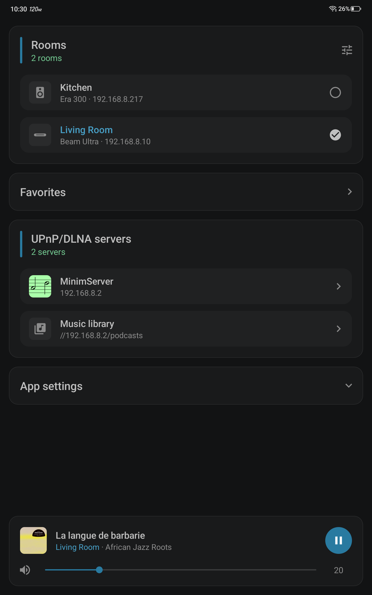
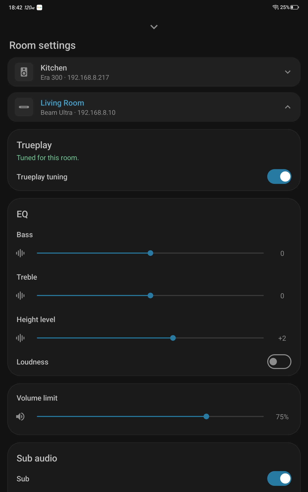
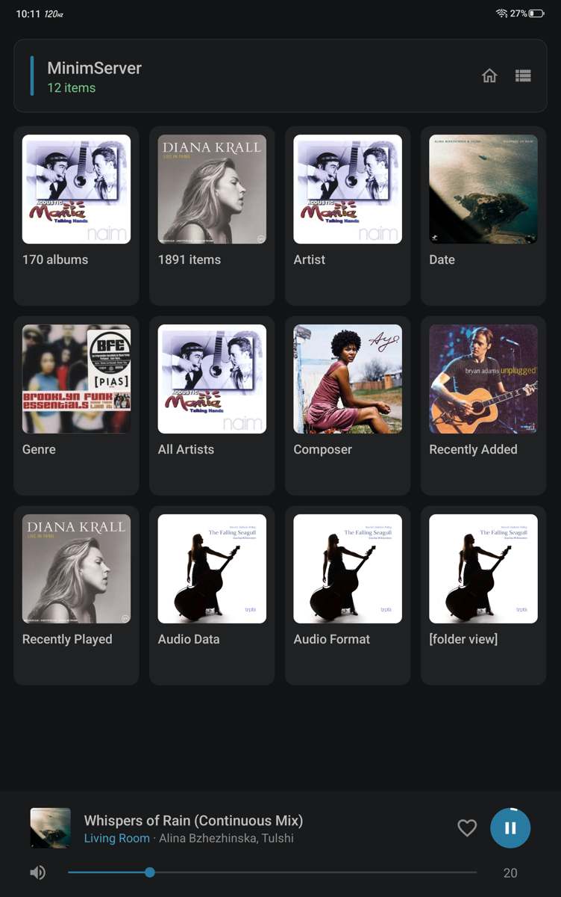

<!-- 2.0 - Copyright (C) 2026 Stouthart. All rights reserved. -->

# Play a UPnP music library on Sonos

A small Android app that browses a **UPnP/DLNA** media server, such as **MinimServer**, and plays its music on **Sonos** speakers, with the queue, the volume and Now Playing at hand. The Sonos system's own **Music library**, the shared folders its speakers play from, is there too. The Sonos app can't play from a UPnP server. UPnP Cast hands the server's own links to the speaker, which then fetches the music itself: the phone isn't in the audio path, so playback goes on when the phone sleeps. No cloud, no ads, no account, no background service, and nothing beyond Android itself: the app is 246 KB.

<p align="center">  </p>

This is **version 2.0**. The [release notes](RELEASE.md) list what each version changed.

## What it does

| Screen         | What it shows                                                                                                         |
| -------------- | --------------------------------------------------------------------------------------------------------------------- |
| Opening screen | The Sonos rooms, each with an icon for its kind of speaker and its model, such as Era 300, Favorites, the UPnP/DLNA servers on the network and the Sonos Music library, and the settings |
| Browse         | A server's own categories, as a list or as tiles, with covers and each track's format, such as `FLAC 44.1 kHz 16-bit`, and in tiles just its length; in an album each track's number before its title |
| Mini player    | At the foot of every screen, from the first time the room has anything loaded; not without WiFi or a Sonos room: the cover, the title, the room and artist, Play/Pause, volume and mute; a title too long for its row slides to its end and back once |
| Now Playing    | A large cover, the source and the format, such as `MinimServer · FLAC 96 kHz 24-bit`, `Qobuz · MP3` or on the TV `HDMI · Dolby Atmos (MAT)`, the format in green when it's lossless, a progress bar to seek, Shuffle, Previous, Play/Pause, Next, Repeat, Quick skip if set, volume and mute |
| Queue          | The room's queue with the playing track marked; a tap plays a track, and Clear queue empties it                       |
| Room settings  | From the icon on the Rooms card: each room's own settings, as in the Sonos app: Trueplay, EQ, Volume limit, Sub audio, Home theater and Hardware |

## Requirements

- **Android 14** or newer
- **Sonos** speakers on the same network
- A **UPnP/DLNA media server** with your music, such as MinimServer, or shared folders in the Sonos **Music library**
- Music files up to **48 kHz**, see [Hi-res files](#hi-res-files)
- To build it yourself: **JDK 21** and the **Android SDK** command-line tools with `platforms;android-37.0` and `build-tools;37.0.0`. The project brings its own Gradle.

Developed and tested on a **Samsung Galaxy S25 Edge** (One UI 9, Android 17) and a **RedMagic Astra** (REDMAGIC OS 11, Android 16), with a **Sonos Beam Ultra** and a Sub Mini in one room and an **Era 300** in another, also grouped (Sonos 27.3), and **MinimServer 2.2**. Other Sonos speakers and UPnP/DLNA servers should work alike, and so should Android 14 and 15, but these are untested.

## Installation

Download `UPnP-Cast-2.0.apk` from the [latest release] and open it on the phone; Android asks to allow installing apps from that source first. Or install it from a computer with the phone connected over USB or wireless debugging:

```bash
adb install UPnP-Cast-2.0.apk
```

### Building it yourself

```bash
git clone https://github.com/Stouthart/UPnP-Cast.git
cd UPnP-Cast
echo "sdk.dir=$ANDROID_HOME" >local.properties   # the SDK's location
./gradlew assembleRelease
adb install app/build.nosync/outputs/apk/release/app-release.apk
```

`./gradlew test` runs the unit tests of the address and subnet checks, the seek format, the cover's size on Now Playing and which of a server's covers it takes, the room icons, the source, the track format and whether it's lossless, a stream's link as its title and the speaker's connecting state, a music service's number and name, Room settings' values and the Sub check, on the computer.

Your build is signed with your own debug key, the release APK with mine. Android won't update one with the other, so uninstall the downloaded app before installing your own build.

[latest release]: https://github.com/Stouthart/UPnP-Cast/releases/latest

## Setup

1. Open **UPnP Cast**. On Android 17, allow **local network access** when asked; older versions don't ask.
2. The Sonos rooms and the UPnP/DLNA servers appear within about a second, and at once from then on, with the **Music library** last when the Sonos system has a shared folder. With more than one room, tap the one to play in: a check marks it, and also the rooms grouped with it, as by the Sonos app; the player then controls them together. With **Group rooms** on in App settings, the checks work as check boxes: the checked rooms play together, and a tap checks or unchecks one. A room you check joins the others and plays what they play, in sync and at their volume; when it's playing something of its own, such as the TV, the app asks first, as joining stops that; one you uncheck leaves and goes quiet, while the others play on, also when it was the one leading them. One room always stays checked.

## Usage

- **Browse:** tap a server. Its categories appear as the server names them. The button at the right of the top card switches between a list and tiles, the house beside it goes back to the opening screen, and Back goes up a level. A long title in the top card gets a little smaller to fit its two lines before it's cut short.
- **Play:** tap a track. It plays in the room with the rest of the list queued around it, as in an album; this replaces the room's queue. On a level with tracks, such as an album, **▶** in the top card plays them all from the first, the same as a tap on the first track. The **⋯** on a track or an album offers **Play now**, **Play next**, **Add to end of queue** and **Replace queue**.
- **Favorites:** the favourites your Sonos system keeps, saved in the Sonos app or elsewhere, such as a radio station or a playlist. A tap on the Favorites panel opens them in Browse, as a list or as tiles; a tap on one plays it in the chosen room: a station starts, a playlist or album replaces the queue. A shortcut, to a page of a service such as Sonos Radio's, can't be played over UPnP, so it's greyed out. The panel shows while there's a favourite to play; they're read again each time the opening screen shows.
- **Music library:** the sections are the Sonos app's: **Artists**, **Albums**, **Composers**, **Genres**, **Songs**, **Imported playlists** and **Folders**. The refresh icon on its first level is the Sonos app's **Scan for new content**: the speaker scans the shared folders, and the icon turns blue and the top card says so until it's done.
- **Mini player:** tap it for Now Playing. The speaker icon mutes and unmutes. With more than one room checked, the player shows them as one, such as **Kitchen + 1**, and its controls act on all of them: the volume sets every speaker to the same level, unlike the Sonos app, which moves them all by the same share. When rooms are grouped or ungrouped elsewhere, as in the Sonos app or by playing Spotify on one of them, every screen follows within a few seconds.
- **Volume buttons:** while UPnP Cast is in front and the mini player or Now Playing shows, the phone's volume buttons set the room's volume, by the **Volume button step**; held, they keep going. Otherwise, and in the background, they're the phone's own; so they are right after choosing another room, until its volume has been read.
- **Now Playing:** drag the progress bar to seek. With **Quick skip** set in App settings, the buttons beside Play skip back or forward by its step, shown in their arrows; they're greyed out where the bar is, as on the TV or a radio stream. Shuffle and Repeat light up while on; Repeat goes from off to all to one. **Queue** opens the room's queue. Close the screen with **⌄**, a swipe down, or Back.
- **Room settings:** the icon at the top right of the Rooms card opens a sheet with the rooms, the one the player controls already open; a tap on another opens its own settings right under it and closes the one before. As the Sonos app has them: **Trueplay tuning**; **EQ** (Bass, Treble, Height level, Loudness); **Volume limit**; **Sub audio** with a bonded Sub (Sub, Sub level, and Phase control while Trueplay is off); **Home theater** on a soundbar (Speech Enhancement, Night Sound, TV dialog sync); and **Hardware** (Status Light, Touch controls). Only what the room's speaker has shows, and a change applies at once.
- **Queue:** tap a track to play it. **Clear queue** asks first.

### App settings

The App settings card opens and closes with a tap on its title; it starts closed and then stays as you left it. When it opens, all of it scrolls into view.

| Setting            | What it does                                                                                                                                                       |
| ------------------ | ------------------------------------------------------------------------------------------------------------------------------------------------------------------ |
| Volume button step | How far a press of the phone's volume buttons moves the room's volume, from ±1 to ±10 (±2 by default)                                                             |
| Group rooms        | **Off**, at first: a tap on a room chooses it, and the speakers stay grouped as they are. **On**: a tap checks or unchecks a room, which joins or leaves the others. Turning it off while rooms play together ends that: the leading room plays on, and the others go quiet |
| Quick skip         | **Off**, at first, or 5 to 60 s in steps of 5: Now Playing then has a button on each side of Play that skips back or forward that far, from where the track is. A skip back stops at the start; one forward past the end goes on to the next track. Quick taps add up |
| Polling interval   | How often the player asks the room what is playing, from 1 to 10 s (2 s by default), for fewer requests on the network while you listen. Now Playing's progress still moves every second |
| Appearance         | **System default** follows the phone; **Light mode** and **Dark mode** set the app's own                                                                           |

## Hi-res files

Sonos plays files up to 48 kHz from a UPnP server. A track above that is greyed out, its format in orange, and a tap says why. When the server offers a version of the track at 48 kHz or lower, UPnP Cast plays that version instead; MinimServer can offer one with its MinimStreamer extension. That path is untested so far.

## Permissions

| Permission                        | Why                                                                                                                                                       |
| --------------------------------- | --------------------------------------------------------------------------------------------------------------------------------------------------------- |
| Local network access (Android 17) | Finding and controlling the speakers and servers                                                                                                          |
| Internet                          | Android requires it for any network connection. UPnP Cast only talks to devices on the local network: the ones that answer its search, at the addresses they give for themselves |
| Network state                     | Following the phone's WiFi as it comes, goes or changes; Android grants it without asking                                                                 |

No other permissions. Nothing runs in the background: the app asks the room what is playing, and watches WiFi, only while one of its screens is open.

## Notes

- The speaker fetches every track from the server itself; UPnP Cast only tells it which. Playback doesn't depend on the phone.
- UPnP Cast remembers the addresses of the speakers and servers, so they appear at once; a search on the network runs alongside and finds any that moved.
- It follows the phone's WiFi. Without it, the screens say **No WiFi connection** and nothing is sent over mobile data. When WiFi comes back, or the phone joins another network, the rooms and servers are searched again and whatever failed loads again. When the home internet is down, Android sends the phone's internet over mobile data, but UPnP Cast stays on the WiFi, so you can still play from the server.
- A link that points away from the device that sent it is refused, and so is a reply bigger or slower than a real device's. Requests go to IP addresses only, never through DNS, each on the WiFi it started on; a room's speaker must be on the phone's own WiFi subnet. The one exception is the Music library's links to its shared folders, which only the speaker opens; the speaker reports no length or sample rate for those tracks, so their rows show just the format, such as `MP3`. Covers come from the server or the speaker only: for a cover on the internet, such as Spotify's, the speaker fetches it and hands it on, so the phone stays on the local network.
- Under a VPN that doesn't let apps bypass it, Android won't keep a request on the WiFi. It then takes the VPN's route, still only to an address on the local network, which the VPN may or may not let through.
- The format line on Now Playing starts with the source, in the Sonos app's words: the server's name, **Music library**, **Spotify**, **AirPlay**, **Sonos Radio**, **Radio** or **Line-in**, and for the TV its input, **HDMI** on a Beam, Arc or Amp, **SPDIF** on a Ray, Playbar or Playbase. Any other music service by the name the speakers give it, such as **Qobuz**, from their own list of services, read once and kept; a service they don't list shows the format alone. The format is what the speaker reports back for the track; for a stream, as from Spotify, also whether it's lossless, such as `Lossless 44.1 kHz 16-bit`. On the TV input it's the format the TV sends, such as `Dolby Atmos (MAT)`, `Dolby Digital 5.1` or `PCM 2.0`. A radio station shows its name after the room and its logo as the cover, as the Sonos app does, both from the speaker; the song, when the station sends it, is the title.
- Turning the phone keeps each screen as it is; the tiles adapt their columns to the width. Now Playing keeps its controls at the bottom, and its cover takes the room above them, larger on a taller screen; in split screen or a small window it shrinks to fit.
- The sliders also follow a keyboard and TalkBack: each step there counts as a drag let go.
- Colours mean the same throughout: blue is what's chosen, on or playing; green good news, such as what was found, a lossless format or a tuned room; orange a problem, such as no WiFi, a room or server that doesn't answer, or a track the speaker can't play.
- Build output goes to `build.nosync` folders, which iCloud Drive doesn't sync.

## Credits

The icons are Google's Material Icons `cast`, `check_circle`, `chevron_right`, `expand_more`, `folder`, `grid_view`, `home`, `library_music`, `more_vert`, `music_note`, `pause`, `play_arrow`, `record_voice_over`, `refresh`, `repeat`, `repeat_one`, `replay`, `shuffle`, `skip_next`, `skip_previous`, `speaker`, `timer`, `tune`, `view_list`, `volume_off` and `volume_up`, under the Apache License 2.0.

## License

Copyright (C) 2026 Stouthart. All rights reserved.

_The source code in this repository is free for personal use. However, it is NOT published under a software license. This implies - as stated in the [GitHub Docs] - that standard copyright law applies, meaning the owner retains all rights to the source code and no one may reproduce, distribute, or create derivative works from this work._

[GitHub Docs]: https://docs.github.com/en/repositories/managing-your-repositorys-settings-and-features/customizing-your-repository/licensing-a-repository
