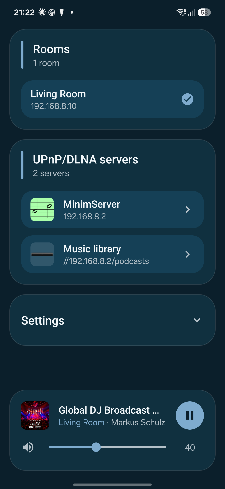

<!-- 1.2 - Copyright (C) 2026 Stouthart. All rights reserved. -->

# Play a UPnP music library on Sonos

A small Android app that browses a **UPnP/DLNA** media server, such as **MinimServer**, and plays its music on **Sonos** speakers, with the queue, the volume and Now Playing at hand. The Sonos system's own **Music library**, the shared folders its speakers play from, is there too. The Sonos app can't play from a UPnP server. UPnP Cast hands the server's own links to the speaker, which then fetches the music itself: the phone isn't in the audio path, so playback goes on when the phone sleeps. No cloud, no ads, no account, no background service, and nothing beyond Android itself: the app is 177 KB.

<p align="center"></p>

This is **version 1.2**. The [release notes](RELEASE.md) list what each version changed.

## What it does

| Screen         | What it shows                                                                                                         |
| -------------- | --------------------------------------------------------------------------------------------------------------------- |
| Opening screen | The Sonos rooms, the UPnP/DLNA servers on the network and the Sonos Music library, and the settings                   |
| Browse         | A server's own categories, as a list or as tiles, with covers and each track's format, such as `FLAC 44.1 kHz 16 bit` |
| Mini player    | At the foot of every screen, from the first time the room has anything loaded; not without WiFi or a Sonos room: the cover, the title, the room and artist, Play/Pause, volume and mute |
| Now Playing    | A large cover, the format (on the TV, its input format), a progress bar to seek, Shuffle, Previous, Play/Pause, Next, Repeat, volume and mute |
| Queue          | The room's queue with the playing track marked; a tap plays a track, and Clear queue empties it                       |

## Requirements

- **Android 14** or newer
- **Sonos** speakers on the same network
- A **UPnP/DLNA media server** with your music, such as MinimServer, or shared folders in the Sonos **Music library**
- Music files up to **48 kHz**, see [Hi-res files](#hi-res-files)
- To build it yourself: **JDK 21** and the **Android SDK** command-line tools with `platforms;android-37.0` and `build-tools;37.0.0`. The project brings its own Gradle.

Developed and tested on a **Samsung Galaxy S25 Edge** (One UI 9, Android 17) and a **RedMagic Astra** (REDMAGIC OS 11, Android 16), with a **Sonos Beam Ultra** and a Sub Mini (Sonos 27.1), and **MinimServer 2.2**. Other Sonos speakers and UPnP/DLNA servers should work alike, and so should Android 14 and 15, but these are untested.

## Installation

Download `UPnP-Cast-1.2.apk` from the [latest release] and open it on the phone; Android asks to allow installing apps from that source first. Or install it from a computer with the phone connected over USB or wireless debugging:

```bash
adb install UPnP-Cast-1.2.apk
```

### Building it yourself

```bash
git clone https://github.com/Stouthart/UPnP-Cast.git
cd UPnP-Cast
echo "sdk.dir=$ANDROID_HOME" >local.properties   # the SDK's location
./gradlew assembleRelease
adb install app/build.nosync/outputs/apk/release/app-release.apk
```

`./gradlew test` runs the unit tests of the address and subnet checks, the seek format and the cover size, on the computer.

Your build is signed with your own debug key, the release APK with mine. Android won't update one with the other, so uninstall the downloaded app before installing your own build.

[latest release]: https://github.com/Stouthart/UPnP-Cast/releases/latest

## Setup

1. Open **UPnP Cast**. On Android 17, allow **local network access** when asked; older versions don't ask.
2. The Sonos rooms and the UPnP/DLNA servers appear within about a second, and at once from then on, with the **Music library** last when the Sonos system has a shared folder. With more than one room, tap the one to play in: a check marks it.

## Usage

- **Browse:** tap a server. Its categories appear as the server names them. The button at the right of the top card switches between a list and tiles, the house beside it goes back to the opening screen, and Back goes up a level. A long title in the top card gets a little smaller to fit its two lines before it's cut short.
- **Play:** tap a track. It plays in the room with the rest of the list queued around it, as in an album; this replaces the room's queue. On a level with tracks, such as an album, **▶** in the top card plays them all from the first, the same as a tap on the first track. The **⋯** on a track or an album offers **Play now**, **Play next**, **Add to end of queue** and **Replace queue**.
- **Music library:** the sections are the Sonos app's: **Artists**, **Albums**, **Composers**, **Genres**, **Songs**, **Imported playlists** and **Folders**. The refresh icon on its first level is the Sonos app's **Scan for new content**: the speaker scans the shared folders, and the top card says so until it's done.
- **Mini player:** tap it for Now Playing. The speaker icon mutes and unmutes.
- **Volume buttons:** while UPnP Cast is in front and the mini player or Now Playing shows, the phone's volume buttons set the room's volume, by the **Volume button step**; held, they keep going. Otherwise, and in the background, they're the phone's own; so they are right after choosing another room, until its volume has been read.
- **Now Playing:** drag the progress bar to seek. Shuffle and Repeat light up while on; Repeat goes from off to all to one. **Queue** opens the room's queue. Close the screen with **⌄**, a swipe down, or Back.
- **Queue:** tap a track to play it. **Clear queue** asks first.

### Settings

The Settings card opens and closes with a tap on its title; it starts closed and then stays as you left it.

| Setting            | What it does                                                                                                                                                       |
| ------------------ | ------------------------------------------------------------------------------------------------------------------------------------------------------------------ |
| Volume button step | How far a press of the phone's volume buttons moves the room's volume, from ±1 to ±10 (±2 by default)                                                             |
| Polling interval   | How often the player asks the room what is playing, from 1 to 10 s (2 s by default), for fewer requests on the network while you listen. Now Playing's progress still moves every second |
| Appearance         | **System default** follows the phone; **Light mode** and **Dark mode** set the app's own                                                                           |

## Hi-res files

Sonos plays files up to 48 kHz from a UPnP server. A track above that is greyed out, and a tap says why. When the server offers a version of the track at 48 kHz or lower, UPnP Cast plays that version instead; MinimServer can offer one with its MinimStreamer extension. That path is untested so far.

## Permissions

| Permission                        | Why                                                                                                                                                       |
| --------------------------------- | --------------------------------------------------------------------------------------------------------------------------------------------------------- |
| Local network access (Android 17) | Finding and controlling the speakers and servers                                                                                                          |
| Internet                          | Android requires it for any network connection. UPnP Cast only talks to devices on the local network: the ones that answer its search, at the addresses they give for themselves |
| Network state                     | Following the phone's WiFi as it comes, goes or changes; Android grants it without asking                                                                 |

No other permissions. Nothing runs in the background: the app asks the room what is playing, and watches WiFi, only while one of its screens is open.

## Notes

- The speaker fetches every track from the server itself; UPnP Cast only tells it which. Playback doesn't depend on the phone.
- UPnP Cast remembers the addresses of the speakers and servers, so they appear at once; a search on the network runs alongside and finds any that moved.
- It follows the phone's WiFi. Without it, the screens say **No WiFi connection** and nothing is sent over mobile data. When WiFi comes back, or the phone joins another network, the rooms and servers are searched again and whatever failed loads again. When the home internet is down, Android sends the phone's internet over mobile data, but UPnP Cast stays on the WiFi, so you can still play from the server.
- A link that points away from the device that sent it is refused, and so is a reply bigger or slower than a real device's. Requests go to IP addresses only, never through DNS, each on the WiFi it started on; a room's speaker must be on the phone's own WiFi subnet. The one exception is the Music library's links to its shared folders, which only the speaker opens; the speaker reports no length or sample rate for those tracks, so their rows show just the format, such as `MP3`. Covers come from the server or the speaker only: for a cover on the internet, such as Spotify's, the speaker fetches it and hands it on, so the phone stays on the local network.
- The format line on Now Playing is what the speaker reports back for the track; for a stream, as from Spotify, also whether it's lossless, such as `Lossless 44.1 kHz 16 bit`. On the TV input it's the format the TV sends, such as `Dolby Atmos (MAT)`, `Dolby Digital 5.1` or `PCM 2.0`.
- Turning the phone keeps each screen as it is; the tiles adapt their columns to the width. In split screen or a small window, Now Playing's cover shrinks to fit.
- The sliders also follow a keyboard and TalkBack: each step there counts as a drag let go.
- Build output goes to `build.nosync` folders, which iCloud Drive doesn't sync.

## Credits

The icons are Google's Material Icons `cast`, `check_circle`, `chevron_right`, `expand_more`, `folder`, `grid_view`, `home`, `more_horiz`, `music_note`, `pause`, `play_arrow`, `refresh`, `repeat`, `repeat_one`, `shuffle`, `skip_next`, `skip_previous`, `timer`, `view_list`, `volume_off` and `volume_up`, under the Apache License 2.0.

## License

Copyright (C) 2026 Stouthart. All rights reserved.

_The source code in this repository is free for personal use. However, it is NOT published under a software license. This implies - as stated in the [GitHub Docs] - that standard copyright law applies, meaning the owner retains all rights to the source code and no one may reproduce, distribute, or create derivative works from this work._

[GitHub Docs]: https://docs.github.com/en/repositories/managing-your-repositorys-settings-and-features/customizing-your-repository/licensing-a-repository
